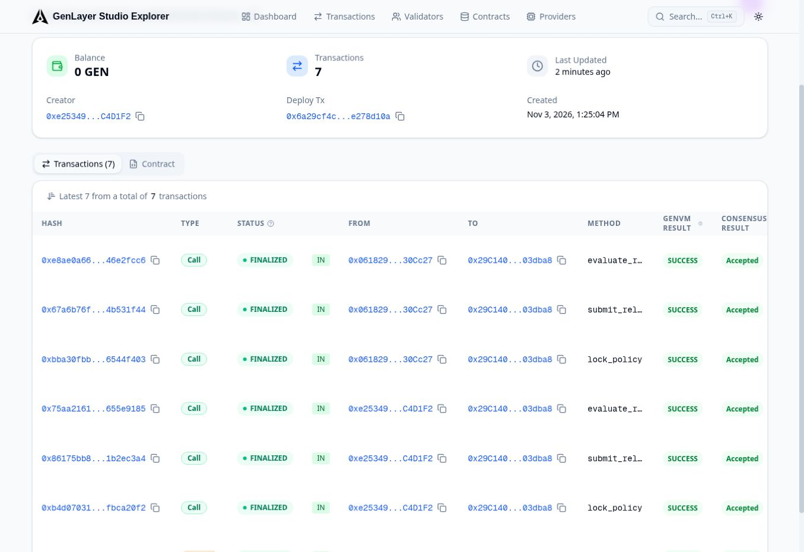

# Live Studionet deployment

Deployment completed on 2026-11-03.

| Field | Value |
| --- | --- |
| Network | Studionet |
| Chain ID | 61999 |
| RPC | https://studio.genlayer.com/api |
| Contract | 0x29C140CAA44978645BFAa830594222DCE703dba8 |
| Source SHA-256 | bb04fea3de48109697eb880110393920daec40bfebeb1ac7191afb605f5158ab |
| Runtime | GenVM v0.2.16; unchanged pinned runner |
| Execution | Normal / Full Consensus, simulation off |
| Finalized transactions | Seven, each showing SUCCESS and accepted consensus in the public explorer |

[Open the deployed contract](https://explorer-studio.genlayer.com/address/0x29C140CAA44978645BFAa830594222DCE703dba8).

## Exact transactions

| Step | Transaction |
| --- | --- |
| Deploy | [0x6a29cf4c…e278d10a](https://explorer-studio.genlayer.com/tx/0x6a29cf4c56878937a30eb2a65f8e5aca6fa2961e5bc8eab4d8cac233e278d10a) |
| Lock policy 1 | [0xb4d07031…fbca20f2](https://explorer-studio.genlayer.com/tx/0xb4d0703161c52b2e78382229323b718c02974db997e07b9a962696aefbca20f2) |
| Submit release 1 | [0x86175bb8…1b2ec3a4](https://explorer-studio.genlayer.com/tx/0x86175bb8805b493032202f22970bb128784d054198dd9d9b23e8efd61b2ec3a4) |
| Evaluate release 1 | [0x75aa2161…655e9185](https://explorer-studio.genlayer.com/tx/0x75aa2161a5f85baa3c96bac095b476fbd01f2694270a0d20906834c1655e9185) |
| Lock policy 2 | [0xbba30fbb…6544f403](https://explorer-studio.genlayer.com/tx/0xbba30fbb8becf05441ae1c40951f59500c0e47d0a72e86eaa445cae76544f403) |
| Submit release 2 | [0x67a6b76f…4b531f44](https://explorer-studio.genlayer.com/tx/0x67a6b76f873b3398ff13307cba5005e5966f3f9a90998fdb582c44274b531f44) |
| Evaluate release 2 | [0xe8ae0a66…46e2fcc6](https://explorer-studio.genlayer.com/tx/0xe8ae0a66fd5794646321561e14e41302fa1fb67adda13c021e18ee1146e2fcc6) |

## Actual assessment results and limitations

| Release | Fixture | Final result | Reason | Completed semantic findings |
| --- | --- | --- | --- | --- |
| 1 | ready | INCONCLUSIVE | SEMANTIC_OUTPUT_INVALID | 0 |
| 2 | rejected | REJECTED | SEMANTIC_OUTPUT_INVALID | 0 |

Release 1 authenticated the evidence and passed both numerical gates, but strict AI-output validation did not complete. Release 2 authenticated the 8500-basis-point F1 measurement against the locked minimum of 9000; that verified hard failure remained REJECTED even though semantic output validation also failed.

These are real finalized on-chain runs, not mocked tests or simulation. They demonstrate source deployment, creator-controlled policy/evidence writes, native nondeterministic execution, consensus acceptance, deterministic numerical enforcement and fail-closed behavior. **They do not establish a successful positive semantic release-readiness assessment.** No RELEASE_READY or completed five-criterion semantic result is claimed. A network-finalized successful transaction is distinct from a positive application verdict.

The first assessment involved three leader rotations and a final majority with both agreeing and disagreeing votes. The contract does not require unanimous network voting. Recorded consensus data is included rather than presenting every validator as agreeing.

## Verification evidence

- deployment.json: network, source checksum, exact transaction IDs and observed outcomes.
- policy-record.json and policy2-record.json: policies read from finalized state.
- ready-receipt.json and rejected-receipt.json: exact finalized get_receipt responses exported through Studio.
- ready-consensus.json and rejected-consensus.json: public explorer consensus data.
- explorer-finalized.txt and live-proof.jpg: public explorer evidence showing all seven writes finalized successfully.
- initial-transaction-summary.json: finalized status, execution and vote summaries from the initial RPC captures.

The deployed source was independently retrieved with gen_getContractCode and compared byte for byte to contracts/model_release_seal.py. Both receipt chains were checked with scripts/verify_receipt.py and passed. Both original evidence manifests match the commit-pinned fixture bytes.

During the run, direct shell access to the RPC became blocked by the workspace network policy. Verification continued through the official Studio UI and public explorer. The reusable read-only scripts/verify_live.py was prepared for independent rechecks in a network-enabled environment; a completed end-to-end run of that new script is not claimed.

~~~sh
python scripts/verify_receipt.py docs/live/policy-record.json docs/live/ready-receipt.json
python scripts/verify_receipt.py docs/live/policy2-record.json docs/live/rejected-receipt.json
pip install -r requirements-live.txt
python scripts/verify_live.py
~~~

## Reuse the existing deployment

In Studio, use Your Contracts → Import Contract and paste the address above. Open Run and Debug. Existing receipts are public: select Finalized state and call get_receipt with 1 or 2. To test your own model, lock your own policy and submit your own release from the same account. No redeployment is needed and the deployer has no global administrative role.

The two recorded policies belong to separate demo accounts. No personal user wallet was required, no real funds were spent, and no private key is published. The bundled reports are explicitly synthetic. Studionet is a development network; state may reset.

